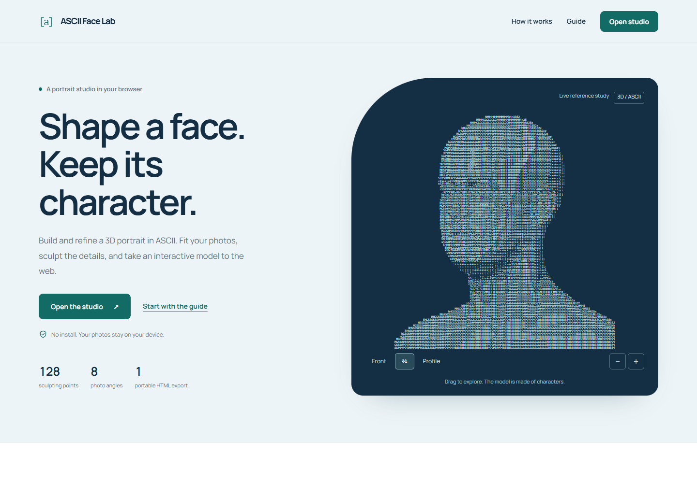

# ASCII Face Lab

A browser-based studio for 3D portraits rendered entirely in ASCII. Fit photographs, refine a face with grouped controls, and export a standalone interactive model.



## Open the lab

Download or clone this private repository, keep its folders together, and open `index.html` in a modern desktop browser. On Windows, double-click **Open-Lab.cmd**. There is no package install or build step.

- **Overview:** `index.html` — interactive reference portrait, workflow, tool overview, working export examples, and FAQ.
- **Guide:** `guide.html` — photo preparation, all eight angles, detection, sculpting, camera controls, export, and troubleshooting.
- **Studio:** `editor/index.html` — the complete editor.
- **Credits:** `credits.html` — asset provenance and third-party licenses.

For local development, any static HTTP server works. For example, if Python is installed, run `python -m http.server 8000` in this folder and open `http://localhost:8000`.

## The studio

- 128 control points in eight groups: face shape, eyes and brows, nose, mouth, ears, head and hair, neck, and shoulders.
- Front, profile, three-quarter, back, and top views; drag rotation, wheel zoom, and keyboard alternatives.
- Eight independent photo slots with pan, zoom, rotation, removal, and detection progress.
- Optional estimation of features from missing views.
- Face-width and head-width controls, undo/redo, background selection, and a confirmation before reset.
- Plain-text frame export and a self-contained HTML viewer.

Photo fitting estimates a shape from the available images. Unseen detail is inferred; it is not a photogrammetric scan. Real side views provide information that a single front photo cannot.

## Photo fitting and privacy

Photographs are processed locally in the browser. This project adds no photo-upload service, analytics, or advertising scripts.

The first detection loads MediaPipe runtimes and models from jsDelivr and Google, ONNX Runtime from jsDelivr, and the bundled BiSeNet parser weights from `models/face-parser-weights.js` (about 71 MB). Keep the models folder in place when hosting the site. Manual editing and standalone exports do not need to download those detection components.

Edits live in the current browser tab. An exported HTML file contains the model and its viewer, not the original photos or an editable project session. Export before closing or reloading the editor.

## Repository privacy and hosting

This repository is private. No GitHub Pages deployment is enabled or automated. A private source repository does not by itself make a GitHub Pages website private.

The app uses relative URLs and can be hosted as a static site, including under a project subdirectory, if you deliberately choose to publish it later. Review the intended audience before enabling any hosting.

## Project structure

```text
index.html                Product overview and live ASCII demo
guide.html                Full portrait tutorial
credits.html              Human-readable credits
editor/index.html         Complete studio and fitting engine
assets/                   Styles, interactions, fonts, reference demo
models/                   Lazy-loaded face-parser weights
licenses/                 Original third-party license texts
docs/                     Design notes and reference-model provenance
tests/check_site.py       Static integrity checks (Python standard library)
```

The demonstrations and overview screenshot are generated from the licensed, unfitted reference scan. No user photographs, photo-fitted models, or Downloads contents are bundled.

## Validation

Run `python tests/check_site.py` to check local links, required assets, file-size limits, and the absence of unintended photo datasets. The interface is also checked in Chromium at desktop and mobile widths, including camera interactions, grouped controls, undo/redo, reset confirmation, photo framing, and exported viewers.

## Credits

Reference scan: **Lee Perry-Smith / Infinite Realities**, adapted, [CC BY 3.0](https://creativecommons.org/licenses/by/3.0/), via [InfiniteScan](https://github.com/keijiro/InfiniteScan). Keep this attribution when sharing derivatives of the base model.

BiSeNet ResNet18 weights: **Yakhyokhuja Valikhujaev**, [face-parsing](https://github.com/yakhyo/face-parsing). Fonts: **Manrope** and **IBM Plex Mono**, self-hosted under their included SIL Open Font Licenses. See [THIRD_PARTY.md](THIRD_PARTY.md) for the complete component list.

Design direction and review draw on Anthropic's [frontend-design](https://github.com/anthropics/skills/tree/main/skills/frontend-design) and Vercel's [web-design-guidelines](https://github.com/vercel-labs/agent-skills/tree/main/skills/web-design-guidelines). The applied design plan is documented in [docs/DESIGN.md](docs/DESIGN.md).
